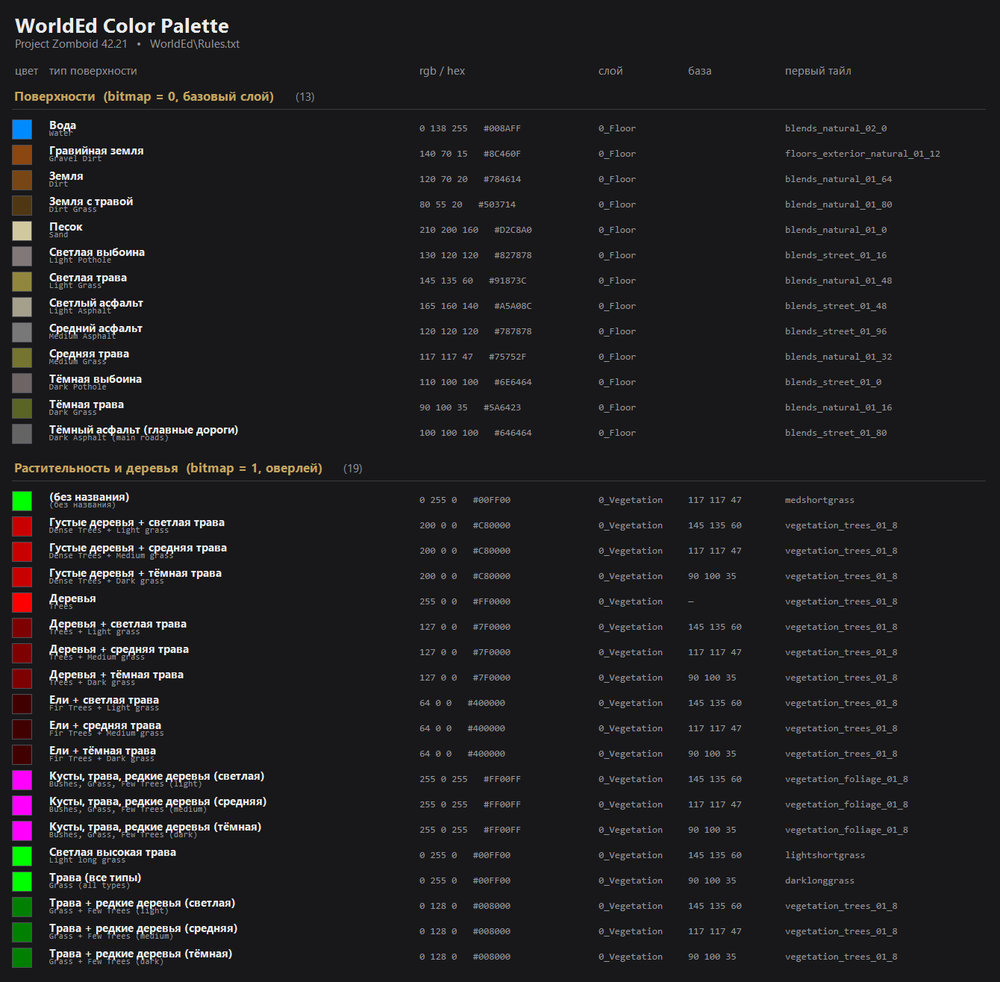

# Цвета карты WorldEd (палитра Project Zomboid)

Соответствие «цвет → тайлы» для рисования карты в WorldEd. Источник — `WorldEd\Rules.txt`
из Project Zomboid Modding Tools (Build 42.21). Сгенерировано автоматически.

Названия переведены на русский; исходные подписи из `Rules.txt` — в колонке «Оригинал».

## Поверхности (`bitmap = 0`)

Базовый слой: цвет заливки клетки целиком заменяется тайлами из правила.

| Свотч | RGB | HEX | Тип поверхности | Оригинал (`Rules.txt`) | Слой | Алиас | Тайлы |
|---|---|---|---|---|---|---|---|
| `#008AFF` | 0 138 255 | `#008AFF` | Вода | Water | `0_Floor` | `water` | `water` → `blends_natural_02_0`, `blends_natural_02_5`, `blends_natural_02_6`, `blends_natural_02_7` |
| `#8C460F` | 140 70 15 | `#8C460F` | Гравийная земля | Gravel Dirt | `0_Floor` | — | `floors_exterior_natural_01_12` |
| `#784614` | 120 70 20 | `#784614` | Земля | Dirt | `0_Floor` | `dirt` | `dirt` → `blends_natural_01_64`, `blends_natural_01_69`, `blends_natural_01_70`, `blends_natural_01_71` |
| `#503714` | 80 55 20 | `#503714` | Земля с травой | Dirt Grass | `0_Floor` | `dirtgrass` | `dirtgrass` → `blends_natural_01_80`, `blends_natural_01_85`, `blends_natural_01_86`, `blends_natural_01_87` |
| `#D2C8A0` | 210 200 160 | `#D2C8A0` | Песок | Sand | `0_Floor` | `sand` | `sand` → `blends_natural_01_0`, `blends_natural_01_5`, `blends_natural_01_6`, `blends_natural_01_7` |
| `#827878` | 130 120 120 | `#827878` | Светлая выбоина | Light Pothole | `0_Floor` | `pothole` | `pothole` → `blends_street_01_16`, `blends_street_01_21` |
| `#91873C` | 145 135 60 | `#91873C` | Светлая трава | Light Grass | `0_Floor` | `lightgrass` | `lightgrass` → `blends_natural_01_48`, `blends_natural_01_53`, `blends_natural_01_54`, `blends_natural_01_55` |
| `#A5A08C` | 165 160 140 | `#A5A08C` | Светлый асфальт | Light Asphalt | `0_Floor` | `lightgravel` | `lightgravel` → `blends_street_01_48`, `blends_street_01_53`, `blends_street_01_54`, `blends_street_01_55` |
| `#787878` | 120 120 120 | `#787878` | Средний асфальт | Medium Asphalt | `0_Floor` | `street` | `street` → `blends_street_01_96`, `blends_street_01_101`, `blends_street_01_102`, `blends_street_01_103` |
| `#75752F` | 117 117 47 | `#75752F` | Средняя трава | Medium Grass | `0_Floor` | `medgrass` | `medgrass` → `blends_natural_01_32`, `blends_natural_01_37`, `blends_natural_01_38`, `blends_natural_01_39` |
| `#6E6464` | 110 100 100 | `#6E6464` | Тёмная выбоина | Dark Pothole | `0_Floor` | — | `blends_street_01_0` |
| `#5A6423` | 90 100 35 | `#5A6423` | Тёмная трава | Dark Grass | `0_Floor` | `darkgrass` | `darkgrass` → `blends_natural_01_16`, `blends_natural_01_21`, `blends_natural_01_22`, `blends_natural_01_23` |
| `#646464` | 100 100 100 | `#646464` | Тёмный асфальт (главные дороги) | Dark Asphalt (main roads) | `0_Floor` | `street2` | `street2` → `blends_street_01_80`, `blends_street_01_85`, `blends_street_01_86`, `blends_street_01_87` |

## Растительность и деревья (`bitmap = 1`, оверлей)

Кладутся поверх базовой поверхности. `condition` — цвет базовой поверхности, на которую
правило наносится (например, «деревья + тёмная трава»).

| Свотч | RGB | HEX | Тип | Оригинал (`Rules.txt`) | Слой | База (`condition`) | Тайлы |
|---|---|---|---|---|---|---|---|
| `#00FF00` | 0 255 0 | `#00FF00` | (без названия) | (без названия) | `0_Vegetation` | `117 117 47` | medshortgrass, medmedgrass, medlonggrass, vegetation_groundcover_01_18, vegetation_groundcover_01_19, vegetation_groundcover_01_21, vegetation_groundcover_01_22, vegetation_groundcover_01_23 |
| `#C80000` | 200 0 0 | `#C80000` | Густые деревья + светлая трава | Dense Trees + Light grass | `0_Vegetation` | `145 135 60` | vegetation_trees_01_8, vegetation_trees_01_9, vegetation_trees_01_10, vegetation_trees_01_11, lightlonggrass |
| `#C80000` | 200 0 0 | `#C80000` | Густые деревья + средняя трава | Dense Trees + Medium grass | `0_Vegetation` | `117 117 47` | vegetation_trees_01_8, vegetation_trees_01_9, vegetation_trees_01_10, vegetation_trees_01_11, medlonggrass |
| `#C80000` | 200 0 0 | `#C80000` | Густые деревья + тёмная трава | Dense Trees + Dark grass | `0_Vegetation` | `90 100 35` | vegetation_trees_01_8, vegetation_trees_01_9, vegetation_trees_01_10, vegetation_trees_01_11, darklonggrass |
| `#FF0000` | 255 0 0 | `#FF0000` | Деревья | Trees | `0_Vegetation` | — | vegetation_trees_01_8, vegetation_trees_01_9, vegetation_trees_01_10, vegetation_trees_01_11 |
| `#7F0000` | 127 0 0 | `#7F0000` | Деревья + светлая трава | Trees + Light grass | `0_Vegetation` | `145 135 60` | vegetation_trees_01_8, vegetation_trees_01_9, vegetation_trees_01_10, vegetation_trees_01_11, lightlonggrass, lightmedgrass, lightshortgrass |
| `#7F0000` | 127 0 0 | `#7F0000` | Деревья + средняя трава | Trees + Medium grass | `0_Vegetation` | `117 117 47` | vegetation_trees_01_8, vegetation_trees_01_9, vegetation_trees_01_10, vegetation_trees_01_11, medlonggrass, medmedgrass, medshortgrass |
| `#7F0000` | 127 0 0 | `#7F0000` | Деревья + тёмная трава | Trees + Dark grass | `0_Vegetation` | `90 100 35` | vegetation_trees_01_8, vegetation_trees_01_9, vegetation_trees_01_10, vegetation_trees_01_11, darklonggrass, darkmedgrass, darkshortgrass |
| `#400000` | 64 0 0 | `#400000` | Ели + светлая трава | Fir Trees + Light grass | `0_Vegetation` | `145 135 60` | vegetation_trees_01_8, vegetation_trees_01_9, lightlonggrass, lightmedgrass, lightshortgrass |
| `#400000` | 64 0 0 | `#400000` | Ели + средняя трава | Fir Trees + Medium grass | `0_Vegetation` | `117 117 47` | vegetation_trees_01_8, vegetation_trees_01_9, medlonggrass, medmedgrass, medshortgrass |
| `#400000` | 64 0 0 | `#400000` | Ели + тёмная трава | Fir Trees + Dark grass | `0_Vegetation` | `90 100 35` | vegetation_trees_01_8, vegetation_trees_01_9, darklonggrass, darkmedgrass, darkshortgrass |
| `#FF00FF` | 255 0 255 | `#FF00FF` | Кусты, трава, редкие деревья (светлая) | Bushes, Grass, Few Trees (light) | `0_Vegetation` | `145 135 60` | vegetation_foliage_01_8, vegetation_foliage_01_9, vegetation_foliage_01_10, vegetation_foliage_01_11, vegetation_foliage_01_12, vegetation_foliage_01_13, vegetation_foliage_01_14, vegetation_trees_01_8 … (+6) |
| `#FF00FF` | 255 0 255 | `#FF00FF` | Кусты, трава, редкие деревья (средняя) | Bushes, Grass, Few Trees (medium) | `0_Vegetation` | `117 117 47` | vegetation_foliage_01_8, vegetation_foliage_01_9, vegetation_foliage_01_10, vegetation_foliage_01_11, vegetation_foliage_01_12, vegetation_foliage_01_13, vegetation_foliage_01_14, vegetation_trees_01_8 … (+6) |
| `#FF00FF` | 255 0 255 | `#FF00FF` | Кусты, трава, редкие деревья (тёмная) | Bushes, Grass, Few Trees (dark) | `0_Vegetation` | `90 100 35` | vegetation_foliage_01_8, vegetation_foliage_01_9, vegetation_foliage_01_10, vegetation_foliage_01_11, vegetation_foliage_01_12, vegetation_foliage_01_13, vegetation_foliage_01_14, vegetation_trees_01_8 … (+6) |
| `#00FF00` | 0 255 0 | `#00FF00` | Светлая высокая трава | Light long grass | `0_Vegetation` | `145 135 60` | lightshortgrass, lightmedgrass, lightlonggrass, vegetation_groundcover_01_18, vegetation_groundcover_01_19, vegetation_groundcover_01_21, vegetation_groundcover_01_22, vegetation_groundcover_01_23 |
| `#00FF00` | 0 255 0 | `#00FF00` | Трава (все типы) | Grass (all types) | `0_Vegetation` | `90 100 35` | darklonggrass, darkmedgrass, darkshortgrass, vegetation_groundcover_01_18, vegetation_groundcover_01_19, vegetation_groundcover_01_21, vegetation_groundcover_01_22, vegetation_groundcover_01_23 |
| `#008000` | 0 128 0 | `#008000` | Трава + редкие деревья (светлая) | Grass + Few Trees (light) | `0_Vegetation` | `145 135 60` | vegetation_trees_01_8, vegetation_trees_01_10, lightlonggrass, lightmedgrass, lightshortgrass, vegetation_groundcover_01_18, vegetation_groundcover_01_19, vegetation_groundcover_01_21 … (+2) |
| `#008000` | 0 128 0 | `#008000` | Трава + редкие деревья (средняя) | Grass + Few Trees (medium) | `0_Vegetation` | `117 117 47` | vegetation_trees_01_8, vegetation_trees_01_10, medlonggrass, medmedgrass, medshortgrass, vegetation_groundcover_01_18, vegetation_groundcover_01_19, vegetation_groundcover_01_21 … (+2) |
| `#008000` | 0 128 0 | `#008000` | Трава + редкие деревья (тёмная) | Grass + Few Trees (dark) | `0_Vegetation` | `90 100 35` | vegetation_trees_01_8, vegetation_trees_01_10, darklonggrass, darkmedgrass, darkshortgrass, vegetation_groundcover_01_18, vegetation_groundcover_01_19, vegetation_groundcover_01_21 … (+2) |

## Как это работает

- В WorldEd клетки карты закрашиваются цветом из таблицы: цвет = правило из `Rules.txt`.
- `tiles` — либо алиас, который в начале `Rules.txt` раскрывается в конкретные спрайты, либо готовый список тайлов.
- Стыки поверхностей обрабатывает `WorldEd\Blends.txt`, дорожную разметку — `WorldEd\Roads.txt`.
- Свои поверхности для мода добавляются такими же блоками `rule { }` в собственном rules-файле и своим цветом палитры.
